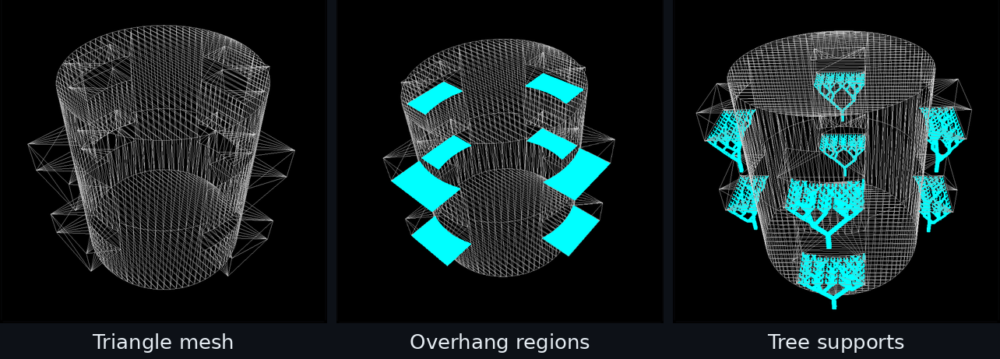
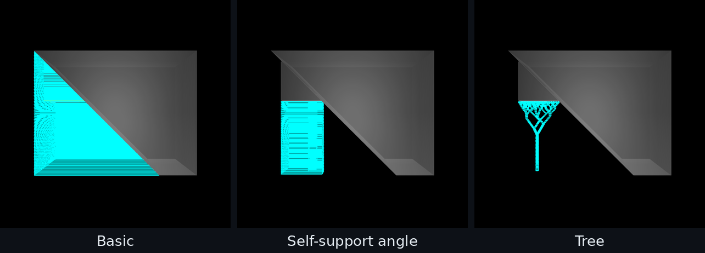
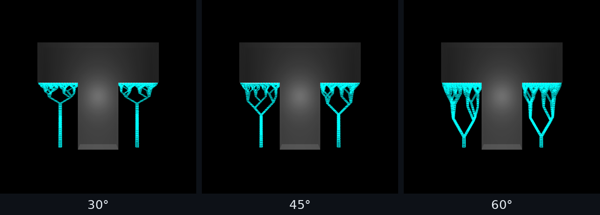
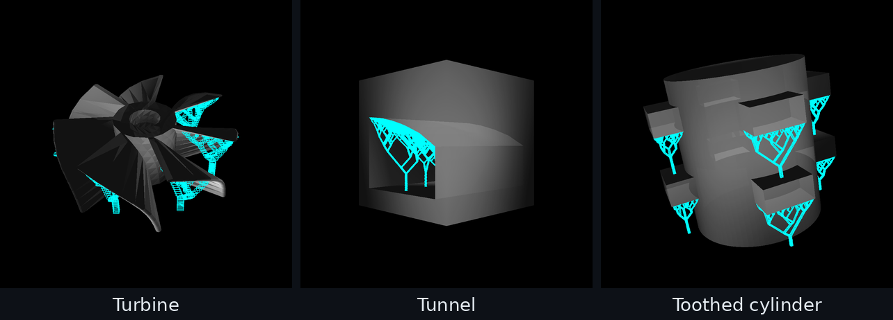

# Tree Support Structures for Additive Manufacturing

My undergraduate thesis (TCC) in Computer Engineering at UTFPR (Universidade Tecnológica Federal do Paraná), Curitiba, 2022. Advisor: Prof. Dr. Ricardo Dutra da Silva.

**Original title:** *Um algoritmo para geração de estruturas de suporte em árvore para manufatura aditiva*. The full text, in Portuguese, is in [`thesis.pdf`](thesis.pdf). This README gives an English summary so you don't have to read all 49 pages.



## The problem

In additive manufacturing (3D printing), an object is built one thin layer at a time, and each layer rests on the one below it. Some parts of a model hang over empty space (**overhangs**). Printed as they are, these parts sag or fail. The usual fix is to print temporary **support structures** underneath them and remove those afterwards.

Supports cost material and time. The simplest approach, filling everything under an overhang straight down to the build plate, can use more material than the object itself. This project looks at **tree-shaped supports**: a few thin "trunks" that branch out to hold up the overhang, instead of solid pillars.

## Approach

The method works on the **sliced** model, meaning the stack of 2D polygons you get by cutting the 3D mesh with horizontal planes, one per printed layer. It doesn't work on the triangle mesh directly. All the support logic comes down to 2D polygon operations between neighbouring layers: offset (grow or shrink), union, intersection and difference.

Three strategies are implemented and compared.

### 1. Basic support
Any area of a layer that has nothing directly underneath it in the layer below is an overhang. That area gets projected straight down until it hits the model or the build plate. A small dilate → union → erode → dilate filter removes slivers and gaps caused by slight misalignment between layers.

### 2. Self-support angle
In practice, a layer can stick out a little past the one beneath it without support. The maximum overhang slope that still prints fine is called the **self-support angle** θ, and 45° is the usual value. Before computing overhangs, the layer below is grown by `Δx = layer_height / tan θ`. That way, gently sloped walls no longer count as needing support. The basic strategy is the same as this one with θ = 90°.

### 3. Tree support
This is the main contribution.

1. **Support points (leaves).** Overhang regions are sampled with a uniform grid of points. These points are the leaves of the trees.
2. **Growing branches.** The method works from the top layer down. Each unconnected node looks for the *closest* junction it can connect to. A junction is only valid inside the node's **support cone**, the region below the point that respects the self-support angle. There are three types of junction:
   - **Base junction:** drop straight down to the build plate, or to a part of the model below (this forms a trunk). This option is always available as a fallback.
   - **V junction:** merge two nodes into a new node placed where their support cones intersect.
   - **Extension junction:** connect to a node that already lies inside the cone. No new node is created.
3. **Fast nearest-junction search.** Finding the shortest possible tree is the Steiner minimal tree problem, which is NP-hard (no known algorithm solves it efficiently at scale). So the method uses a greedy heuristic instead. Each layer is split into a grid of cells, and a **breadth-first search** (BFS) expands outward ring by ring from the node's cell to find nearby candidates without comparing against every node. Once a candidate is found, geometric bounds (the candidate's distance, the self-support cone and the base below the node) narrow down which layers and cells are still worth searching. Layers with few nodes (fewer than τ) are simply searched exhaustively.
4. **Validation.** Each candidate branch is interpolated layer by layer and checked with point-in-polygon tests, so it doesn't pass through the model or end below the build plate. If a candidate fails, the next-best one is tried.
5. **From graph to printable layers.** Branches are subdivided so there's a point on every layer they cross. A polygon is placed at each point, and its size grows with depth, so trunks come out thicker than the twigs near the leaves.



The branch angle can be set separately from the angle used to detect overhangs. Smaller angles merge branches into a trunk sooner and use less material:



## Results

Experiments ran on six test models: Ramp, T, Turbine, Tunnel, Toothed cylinder and Dinosaur. Settings were 0.254 mm layers, 1 mm leaf spacing, a 45° branch angle and τ = 50.



**Support volume as a percentage of the model's own volume** (lower is better):

| Model            | Basic   | Self-support | Tree   |
|------------------|--------:|-------------:|-------:|
| Toothed cylinder | 15.85%  | 15.85%       | 0.31%  |
| Dinosaur         | 37.36%  | 19.16%       | 3.04%  |
| T                | 72.53%  | 72.53%       | 1.58%  |
| Tunnel           | 55.16%  | 55.07%       | 1.22%  |
| Ramp             | 59.31%  | 7.11%        | 0.14%  |
| Turbine          | 283.99% | 190.66%      | 12.45% |

**Computation time in seconds** (mean ± deviation over 10 runs):

| Model            | Basic         | Self-support  | Tree        |
|------------------|--------------:|--------------:|------------:|
| Toothed cylinder | 2.76 ± 0.02   | 2.56 ± 0.04   | 3.90 ± 0.05 |
| Dinosaur         | 1.45 ± 0.02   | 2.74 ± 0.01   | 4.59 ± 0.05 |
| T                | 0.081 ± 0.004 | 0.120 ± 0.004 | 0.71 ± 0.01 |
| Tunnel           | 0.54 ± 0.01   | 0.64 ± 0.01   | 34.7 ± 1.1  |
| Ramp             | 0.132 ± 0.005 | 0.165 ± 0.004 | 0.64 ± 0.01 |
| Turbine          | 0.65 ± 0.01   | 0.76 ± 0.01   | 1.21 ± 0.02 |

In short, tree supports cut support material sharply on every model tested. They always took longer to compute than the simpler strategies, but on most models that still meant only a few seconds. The exception was the large Tunnel model, which has many more layers and leaf nodes, and took about 35 s. The thesis also analyses the search itself: how many layers, cells and candidates are visited per node. In the typical case, the search finishes after checking very few of them.

## Implementation

- Python 3.8
- [Shapely](https://shapely.readthedocs.io/) for 2D polygon operations
- Mesh slicing uses the algorithm by Minetto et al. (2017): [rminetto/slicing](https://github.com/rminetto/slicing)

## Possible extensions

These are the directions listed in the thesis:
- Let branches attach to the side of the model, not only to the plate or a surface directly below.
- Alternatively, steer trees toward the build plate to reduce contact with the part and make removal easier.
- Make the tips that touch the model thinner.
- Size branches based on structural stability.

## Citation

```bibtex
@thesis{silva2022tree,
  author = {Silva, Gustavo Timmermans Pires da},
  title  = {Um algoritmo para gera{\c{c}}{\~a}o de estruturas de suporte em {\'a}rvore para manufatura aditiva},
  type   = {Bachelor's thesis (Computer Engineering)},
  school = {Universidade Tecnol{\'o}gica Federal do Paran{\'a}},
  address = {Curitiba},
  year   = {2022}
}
```

## License

The thesis is published under [Creative Commons Attribution 4.0 International (CC BY 4.0)](https://creativecommons.org/licenses/by/4.0/), and the summary and figures in this repository use the same license. Third-party works cited in the thesis are not covered.
